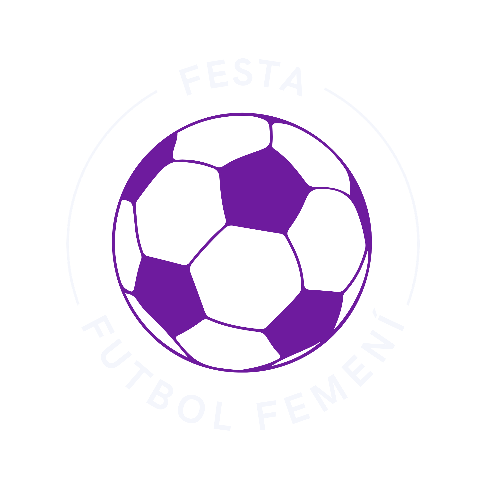

<div align="center">
  

  # ⚽ La Gran Festa del Futbol Femení

  **Tres dies per celebrar el talent, la passió i el futur del futbol femení.**

  Una web informativa per descobrir l'esdeveniment, consultar-ne el programa i apuntar-s'hi.

  <br>

  
  
  
  
</div>

---

## ✨ Sobre el projecte

La **Gran Festa del Futbol Femení** és un projecte web estàtic dedicat a un esdeveniment de tres dies que posa en valor les jugadores, els clubs i les persones que fan créixer aquest esport.

El lloc combina informació pràctica amb una experiència visual pensada per convidar tothom a participar-hi.

## 🌷 Què hi trobaràs?

| Secció | Què ofereix |
| --- | --- |
| **Inici** | Presentació de l'esdeveniment, dates, itinerari i patrocinadors |
| **FAQ** | Respostes a les preguntes més freqüents |
| **Registre** | Formulari per apuntar-s'hi |
| **Galeria** | Fotografies d'esdeveniments i galeria interactiva |
| **Contacte** | Formulari, informació de contacte i mapa |
| **Informació legal** | Termes i condicions, privadesa i política de cookies |

## 🪄 Tecnologies

- **HTML** per estructurar les pàgines.
- **CSS** per al disseny i l'adaptació a diferents pantalles.
- **JavaScript** per a les interaccions de la galeria i el missatge de benvinguda.

No cal instal·lar dependències: és un projecte estàtic.

## 🚀 Com obrir-lo

1. Descarrega o clona aquest repositori.
2. Obre `index.html` al navegador.

Per treballar-hi còmodament, també pots obrir la carpeta amb VS Code i servir-la amb una extensió com **Live Server**.

## 🗂️ Estructura

```text
.
├── index.html
├── contacte.html
├── faq.html
├── galeria.html
├── registre.html
├── cookies.html
├── politica.html
├── termes-condicions.html
├── style.css
├── benvinguda.js
├── galeria.js
└── img/
```

## ℹ️ Nota

Els formularis són part de la interfície del projecte; no hi ha cap servei de servidor configurat per rebre o desar les dades.

---

<div align="center">
  Fet amb ❤️ per **Nena & Júlia** · *El futbol també és nostre.*
</div>


URL firebase Hosting: https://projecte-1-132c8.web.app/
